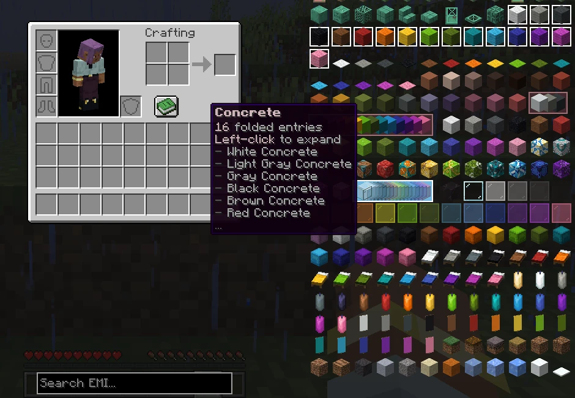
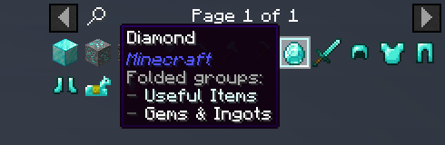
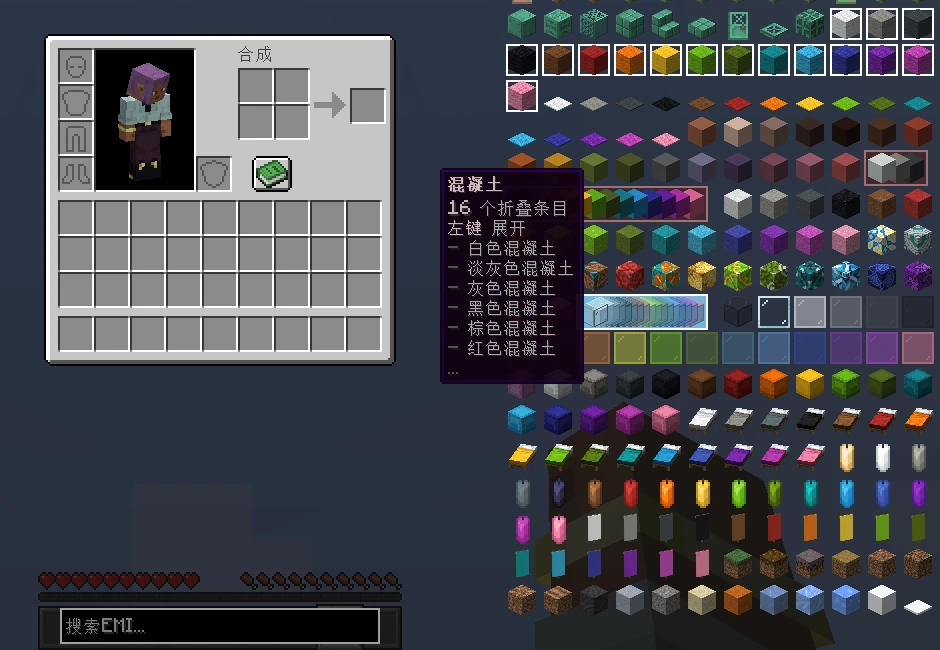
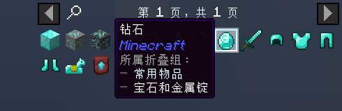

# Bro Know My EMI Folder

[](https://github.com/bro-know-my-org/BroKnowMyEmiFolder/releases/latest)
[](https://www.curseforge.com/projects/1564728)
[](LICENSE)

[English](#english) · [简体中文](#简体中文)

**[Documentation & changelog / 文档与更新记录 →](https://emi-folder.bro-know-my.org/)**

## English

Turn a crowded EMI sidebar into collapsible folders defined by your modpack. BKMEF is an EMI addon for **Minecraft 1.21.1 · NeoForge**, with **KubeJS** scripts controlling what goes in each folder and how it looks.

### Make it yours

- **Choose the contents.** Group items and fluids by ID, tag, mod, or combined filters. Exclude individual entries, or let an item belong to several folders.
- **Choose the look.** Set folder names, translations, colors, and card spacing. Use fixed colors, a rainbow, or randomly assigned colors.
- **Keep browsing naturally.** Left-click to expand; Alt + left-click a member to collapse. Search finds individual items inside folders and deduplicates overlapping results.



*A vanilla-only example with custom names, colors, and card spacing. Folders can stay folded while others are expanded.*



*One diamond, two folders: search shows the item once and lists both memberships in its tooltip.*

### Get started

Install [BKMEF](https://www.curseforge.com/projects/1564728), [EMI](https://modrinth.com/mod/emi), and [KubeJS](https://kubejs.com/) for NeoForge 1.21.1, with their required dependencies. BKMEF requires EMI **1.1.22+** and KubeJS **2101.7.2+**.

Save this as `kubejs/client_scripts/emi_folders.js` in your instance, then launch the game:

```js
RecipeViewerEvents.fold(event => {
  event.fold('my_pack:logs', 'Logs', '#minecraft:logs', {
    spread: 4,
    color: '#68B984'
  })
  event.unfold('my_pack:logs', 'minecraft:stripped_oak_log')
})
```

This folds logs into a green folder while keeping stripped oak logs separate. **You define the folders**; installing the addon alone does not choose groups for your pack.

Find setup instructions, filters, styling options, the KubeJS API, and the changelog on the **[project website](https://emi-folder.bro-know-my.org/)**. The [screenshot example](https://emi-folder.bro-know-my.org/examples#readme-showcase) includes the full script and both translations.

## 简体中文

把拥挤的 EMI 侧栏整理成适合你的整合包的折叠分组。BKMEF 是适用于 **Minecraft 1.21.1 · NeoForge** 的 EMI 附属模组，通过 **KubeJS** 自由定义分组内容和外观。

### 按你的想法整理

- **内容自由组合。** 按 ID、标签、模组或组合条件归类物品与流体；可以排除指定条目，也可以让一个物品同时属于多个组。
- **外观自己决定。** 自定义组名、翻译、颜色和卡片间距，支持固定色、彩虹色和随机配色。
- **照常浏览和搜索。** 左键展开，Alt + 左键点击成员收起。搜索直接显示组内匹配的物品，跨组重复的结果只显示一次。



*仅用原版物品演示自定义组名、配色和卡片间距；不同分组可以分别展开或保持折叠。*



*一颗钻石，两个分组：搜索结果只出现一次，悬停提示列出它所属的两个组。*

### 开始使用

安装适用于 NeoForge 1.21.1 的 [BKMEF](https://www.curseforge.com/projects/1564728)、[EMI](https://modrinth.com/mod/emi)、[KubeJS](https://kubejs.com/) 及其前置依赖。需要 EMI **1.1.22+**、KubeJS **2101.7.2+**。

在游戏实例的 `kubejs/client_scripts/emi_folders.js` 中写入，然后启动游戏：

```js
RecipeViewerEvents.fold(event => {
  event.fold('my_pack:logs', '原木', '#minecraft:logs', {
    spread: 4,
    color: '#68B984'
  })
  event.unfold('my_pack:logs', 'minecraft:stripped_oak_log')
})
```

这会把原木收进绿色分组，同时让去皮橡木原木单独显示。**分组由你定义**，仅安装模组不会自动替整合包分类。

安装指南、过滤规则、外观选项、KubeJS 接口和更新记录统一见 **[项目网站](https://emi-folder.bro-know-my.org/)**。[截图示例](https://emi-folder.bro-know-my.org/examples#readme-showcase)提供完整脚本和中英文翻译。

---

[Report an issue / 反馈问题](https://github.com/bro-know-my-org/BroKnowMyEmiFolder/issues) · [MIT](LICENSE) · Inspired by / 折叠交互灵感来自 [REI](https://github.com/shedaniel/RoughlyEnoughItems)
